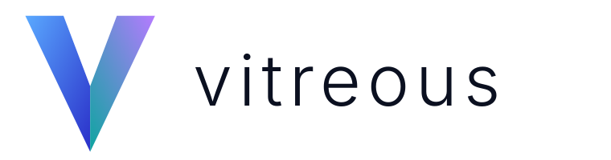

<p align="center">
  
</p>

# Vitreous

A private, fast, deeply customizable browser with a liquid-glass interface.

## Status

**Early prototype.** The interface is real and runs today. The engine layer is not built yet.

| Part | State |
|---|---|
| Glass UI shell (tabs, spaces, sidebar, address bar) | Working |
| Command palette (`Ctrl K`) | Working |
| Settings and live theming (theme, accent, background, blur, tint, radius, tab layout) | Working |
| HTTPS-only upgrade, search engine choice | Working |
| Web content | Sandboxed `<iframe>` preview. Many sites refuse to load in frames |
| Tracker blocking, fingerprint resistance, Do Not Track | Interface only. Needs the engine layer |
| Rendering engine | Not started |

## Run it

No build step. Open `index.html` in any modern browser, or serve the folder:

```sh
python3 -m http.server 8080
```

Then visit `http://localhost:8080`.

## Shortcuts

| Action | Keys |
|---|---|
| New tab | `Alt T` |
| Close tab | `Alt W` |
| Focus address bar | `Alt L` |
| Toggle sidebar | `Alt B` |
| Settings | `Alt ,` |
| Command palette | `Ctrl K` (`Cmd K` on Mac) |

## Engine plan

Writing a rendering engine from scratch is a multi-year effort. Vitreous takes the practical route: embed an existing engine and own everything around it.

1. **Now:** UI shell and design system (this repo).
2. **Next:** embed Chromium (CEF) or Gecko behind the same shell. Real tabs, history, downloads.
3. **Then:** privacy layer (filter lists, fingerprint resistance, encrypted DNS), extension support, local-first sync.
4. **Later:** installers, auto-update, and a security-patch pipeline that tracks upstream engine fixes.

## Layout

```
index.html        app shell
css/vitreous.css  liquid-glass design system
js/app.js         tabs, spaces, settings, command palette
assets/           logo (SVG and PNG) and favicon
```

## Brand

- Mark: a faceted glass "V". Light-background colors are the default.
- Palette: `#5aa9ff` blue, `#b57bff` violet, `#0ea5a0` teal.
- Wordmark: lowercase `vitreous`, light weight, wide tracking. The typeface is not final yet.
